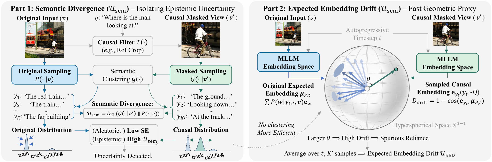
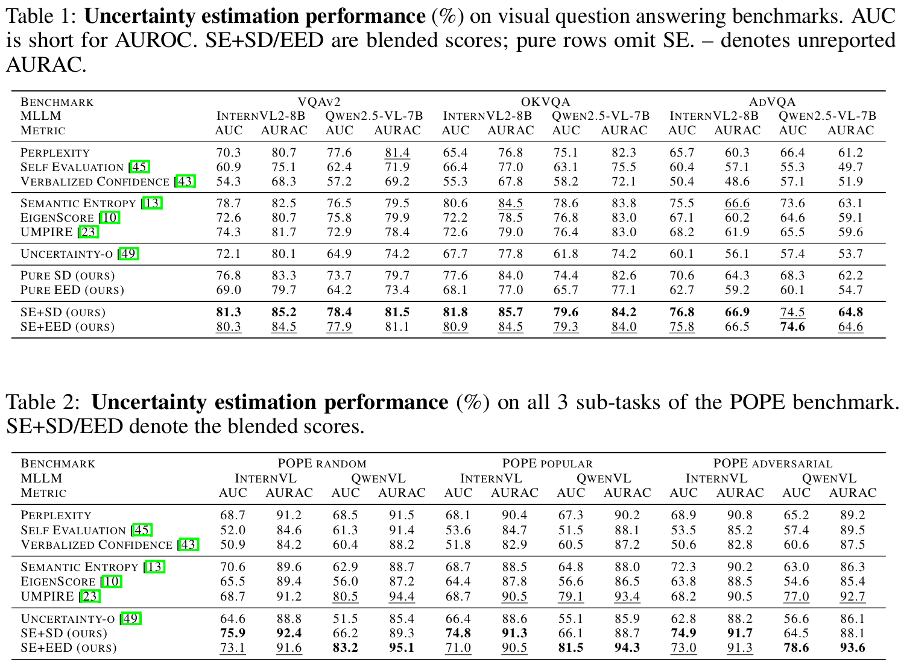

# Causal-Invariant Masking (CIM)

Code for paper [**Revealing Epistemic Uncertainty in MLLMs via Causal-Invariant Masking**](https://arxiv.org/pdf/2610.02887).


Haoyang Luo, Linwei Tao, Jie Gui, Xinghao Chen, Chang Xu, Jianyuan Guo, Minjing Dong*

## Overview

CIM estimates uncertainty in multimodal large language models (MLLMs) by
comparing their predictions on an original image and a question-relevant
region-of-interest (RoI) crop. It provides two uncertainty scores:

- **Semantic Divergence (SD):** compares semantic answer distributions between
  the original and cropped views.
- **Expected Embedding Drift (EED):** estimates the shift using answer-token
  embeddings as a faster proxy.

This repository contains the main hallucination-detection pipeline for VQA,
POPE, and MME, including preparation and evaluation of both scores.

## Contents

- [Method](#method)
- [Installation](#installation)
- [Data preparation](#data-preparation)
- [Run](#run)
- [Results](#results)
- [Code structure](#code-structure)
- [Acknowledgements](#acknowledgements)
- [Citation](#citation)
- [License](#license)

## Method

Causal-Invariant Masking (CIM) probes epistemic uncertainty through the stability of a model’s predictions when query-irrelevant visual context is removed. Its central principle is that predictions grounded in the relevant visual evidence should remain stable when that evidence is preserved in a focused view.

CIM extracts key objects from the question and initial answer, then uses GroundingDINO to construct a region-of-interest (RoI) crop. Semantic Divergence (SD) quantifies the shift between the semantic answer distributions of the original and cropped views, revealing sensitivity to potentially misleading context. Expected Embedding Drift (EED) provides an efficient geometric proxy by measuring token-level embedding drift for responses sampled from the cropped view, avoiding explicit semantic clustering. These context-sensitivity signals complement Semantic Entropy and are combined with it for hallucination detection.

<p align="center">
     <br>
</p>

## Installation

Run from the repository root in a fresh environment:

```bash
conda create -n cim python=3.11.11
conda activate cim

# Install the CUDA 12.8 PyTorch wheels before other dependencies.
python -m pip install pip==25.1
python -m pip install torch==2.10.0 torchvision==0.25.0 --index-url https://download.pytorch.org/whl/cu128
python -m pip install -r requirements.txt

# Install FlashAttention last, using the installed PyTorch build.
# Source builds require a CUDA toolkit/compiler; see the note below.
python -m pip install setuptools==78.1.1 wheel==0.45.1 ninja==1.13.0
python -m pip install flash-attn==2.8.3 --no-build-isolation
python -m pip check
```

Supported model arguments:

| Argument | Model |
|---|---|
| `QwenVL` | Qwen2.5-VL-7B-Instruct |
| `InternVL` | InternVL2-8B |

## Data preparation

----

Supported benchmark arguments are `VQAv2`, `OKVQA`, `AdVQA`, `POPE_rand`,
`POPE_pop`, `POPE_adv`, and `MME`. The POPE suffixes select random, popular,
and adversarial splits, respectively.

VQAv2, OKVQA, POPE, and MME are loaded through Hugging Face Datasets.
`commands.sh` defaults the Hugging Face cache to `.cache/huggingface/`, unless
`HF_HOME` is already set.

For AdVQA, place the dataset files in the following layout:

```text
data/AdVQA/
├── v1_OpenEnded_mscoco_val2017_advqa_questions.json
├── v1_mscoco_val2017_advqa_annotations.json
└── val2014.zip    # Contains the val2014/ image directory
```

Dataset files and model weights are not bundled with this repository.

## Run

### Full pipeline

Run all three stages for one model and benchmark:

```bash
CUDA_VISIBLE_DEVICES=[...] bash commands.sh InternVL VQAv2
```

Replace the model and benchmark with any supported arguments above. Omitting both arguments runs both models on all seven benchmarks sequentially.

### Individual stages

For example, prepare and evaluate the first 100 VQAv2 examples:

```bash
# 1. Prepare answers, RoI crops, samples, labels, and SD distributions.
CUDA_VISIBLE_DEVICES=[...] python prepare_sd.py --mllm InternVL --benchmark VQAv2 --subset 0 100

# 2. Compute EED embeddings from the prepared SD records.
CUDA_VISIBLE_DEVICES=[...] python prepare_eed.py --mllm InternVL --benchmark VQAv2 --subset 0 100

# 3. Evaluate SD and EED without loading models.
python evaluate_uncertainty.py --mllm InternVL --benchmark VQAv2 --subset 0 100
```

`--subset START END` uses an inclusive start and exclusive end. Use matching
model, benchmark, and sampling settings across stages. Without `--subset`,
the pipeline uses the first 2,000 VQA examples, 3,000 examples per POPE split,
and 2,374 MME examples. Completed preparation records are reused on restart;
do not run simultaneous writers on the same intermediate file.

### Outputs

- `exp_cim/arch/`: intermediate Python shelve databases for SD and EED.
- `exp_cim/results/`: JSON metrics and per-example score CSVs.

Evaluation reports Semantic Entropy (SE), pure SD/EED, and their blends with
SE, using `--lambda 0.05` by default. Metrics are AUROC (area under the ROC
curve) and AURAC (integrated retained-answer accuracy); higher is better.
Use `--help` on each script to see its available arguments.

## Results

<p align="center">
     <br>
</p>

## Code structure

```text
.
├── prepare_sd.py             # Answers, crops, sampling, semantic distributions
├── prepare_eed.py            # EED embedding preparation
├── evaluate_uncertainty.py   # SD/EED scoring and AUROC/AURAC evaluation
├── commands.sh              # Run the three stages sequentially
├── benchmark/               # VQA, POPE, and MME loaders
├── factory/                 # Model and benchmark selection
├── gsa/                     # GroundingDINO region detection
├── llm/                     # Helper LLM for answer checking and clustering
├── mllm/                    # QwenVL and InternVL wrappers
├── metric/                  # AUROC and AURAC implementations
├── util/                    # Shared arguments, storage, crops, and EED scoring
├── requirements.txt
└── LICENSE
```

## Citation

If you find our work helpful in your research or application, you are welcome to cite CIM:

```bibtex
@article{luo2026revealing,
  title={Revealing Epistemic Uncertainty in MLLMs via Causal-Invariant Masking},
  author={Luo, Haoyang and Tao, Linwei and Gui, Jie and Chen, Xinghao and Xu, Chang and Guo, Jianyuan and Dong, Minjing},
  journal={NeurIPS},
  year={2026}
}
```

## Acknowledgements

This implementation uses Qwen, InternVL, GroundingDINO, and Hugging Face
Transformers and Datasets. Existing third-party attribution and license
notices are retained in the corresponding source files.

## License

Original project code is released under the [MIT License](LICENSE).
The incorporated `benchmark/comprehension/AdVQABuilder.py` loader, including
our modifications, is licensed under [Apache-2.0](licenses/Apache-2.0.txt).
See [Third-party notices](THIRD_PARTY_NOTICES.md) for attribution and source
information. Other third-party notices remain applicable; model weights and
datasets are subject to their respective terms and are not relicensed by MIT.